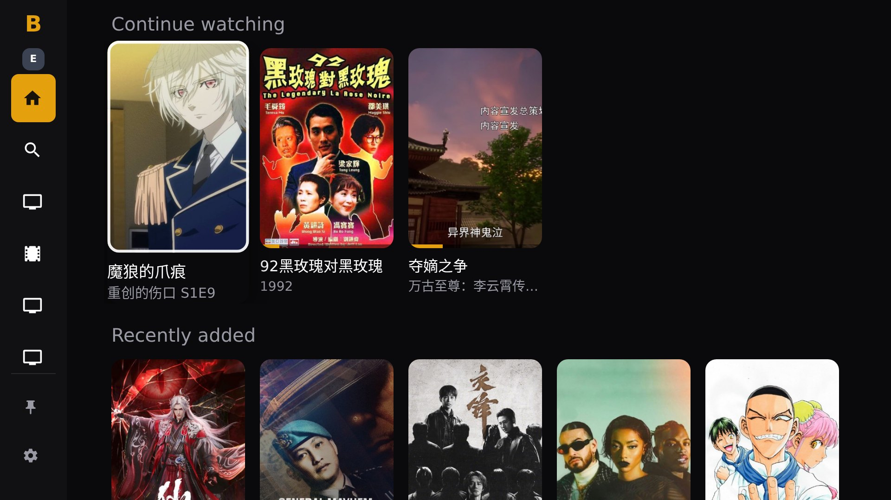
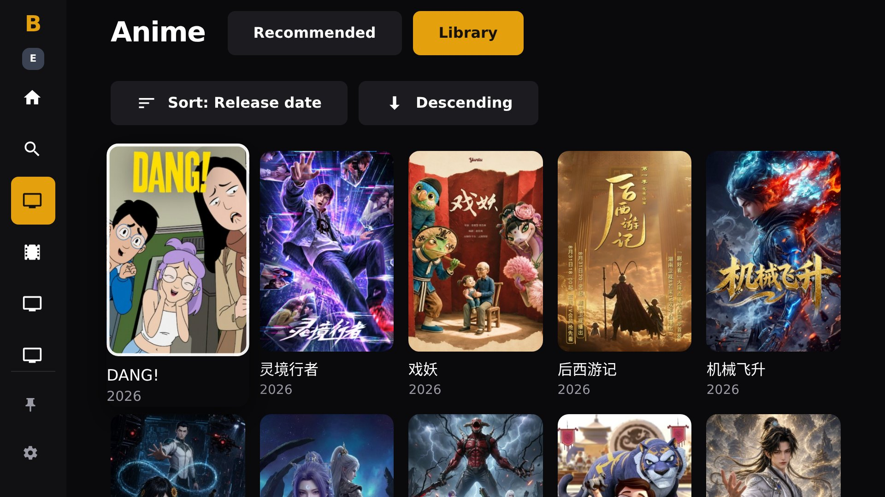
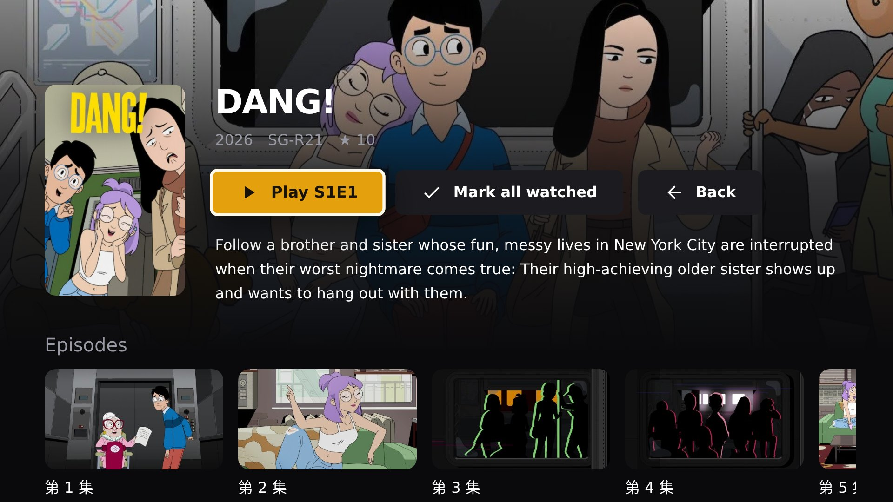
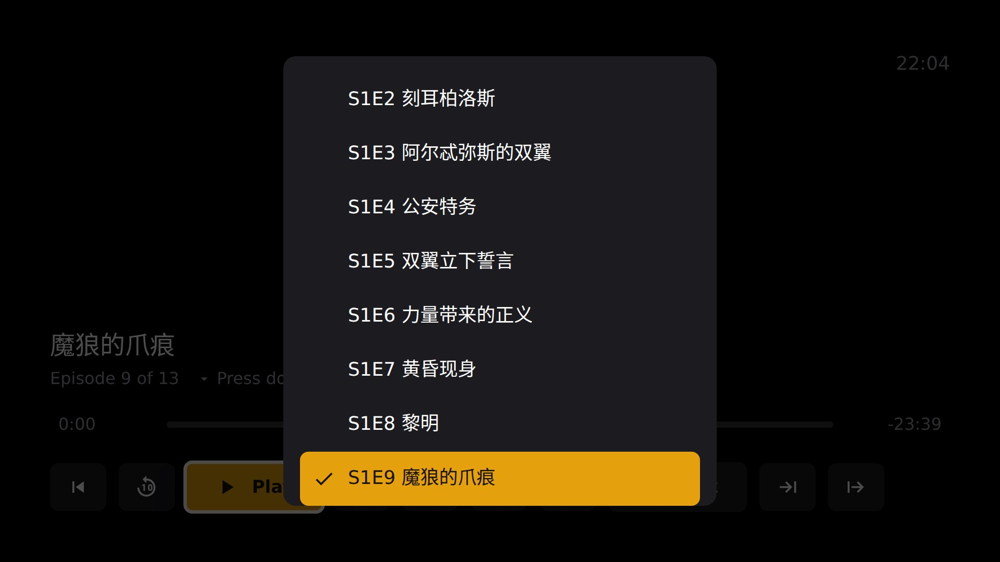
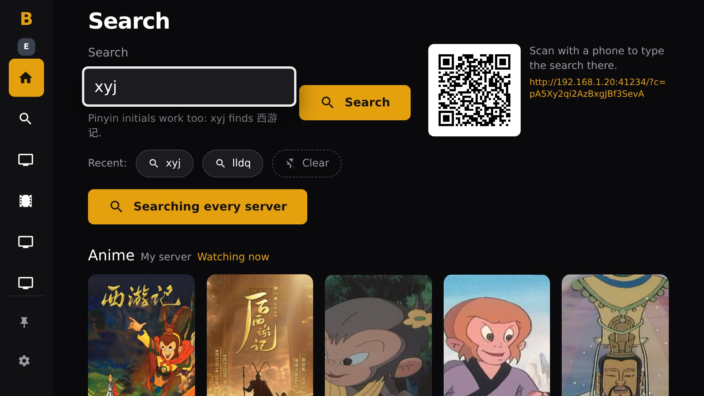
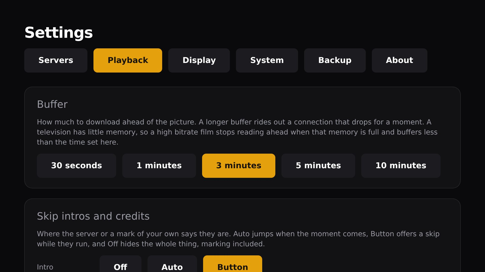

[简体中文](README.md) | English

An Emby client for Android TV, built for a remote control rather than a touchscreen.

**Latest version 0.6.26**, released 2026-11-12. Requires Android 7.0 or newer
(API 24).

## Screenshots

On a television, at 1080p.

<table>
<tr>
<td></td>
<td></td>
</tr>
<tr>
<td></td>
<td></td>
</tr>
<tr>
<td></td>
<td></td>
</tr>
</table>

## Download

| Download | Best for | Size |
| --- | --- | --- |
| [universal](https://github.com/liveinaus/bemplayer/releases/download/v0.6.26/bemplayer-0.6.26-universal.apk) | Works on every Android TV device | 25.1 MB |

`universal` is the one to take: it works on every device. If Bemplayer opens with a screen
saying the TV's WebView is too old, that screen says what can be done, and on a TV with
Google's WebView it can download and install a newer one itself. A newer WebView is a
system component shared by every app on the TV, and Settings → Apps → Android System
WebView → Uninstall updates puts the old one back.

## Install

Android TV will not install an app from a file until you allow it. The prompt appears the
first time and points at the right settings screen.

**With a file manager or sideload app** such as Downloader or Send Files to TV: copy the
APK across, open it, and accept the install prompt.

**With adb**, from a computer on the same network:

```bash
adb connect <tv-ip>:5555
adb install -r bemplayer-0.6.26-universal.apk
```

Then open Bemplayer from the Android TV home screen and enter your Emby server address,
for example `http://192.168.1.10:8096`.

## Updates

Bemplayer checks for new versions on its own and can install them without a computer.
Settings, then Updates, then Check now. Auto check is on by default and can be turned off
on the same screen.

The first update asks you to allow Bemplayer to install apps. That permission is what lets
it replace itself, and the app takes you straight to the setting.

## Using the remote

| Key                | In the player                                                              |
| ------------------ | -------------------------------------------------------------------------- |
| Centre, play/pause | Play or pause                                                              |
| Left, right        | Seek. Hold to go faster: 10s, 30s, 1m, 5m                                  |
| Up                 | Up a row of buttons; from the top row, hide the controls                   |
| Down               | Down a row of buttons; again for the episode strip; hold for the list      |
| Back               | Close the menu or QR code, then the episode strip, then ask before leaving |

Anywhere else, Back goes back one screen and never closes the app on its own. At the
screen with nothing behind it, Back asks whether to quit Bemplayer; holding Back leaves
at once, without asking.

The green button opens the logs from any screen (Settings › System › Logs on a remote
without one), which is the quickest way to get
information for a bug report.

## What is in this release

### 修复 / Fixed

- 修复部分服务器播放时报 `ERROR_CODE_IO_BAD_HTTP_STATUS: Response code 404`：服务器给出的相对播放地址现在按 Emby 客户端的方式接在 `/emby` 下面，而不是接在服务器根地址上。普通 Emby 两种写法都接受，只走 `/emby` 的前端之前会返回 404。字幕地址同样处理。 / Fixed playback failing with `ERROR_CODE_IO_BAD_HTTP_STATUS: Response code 404` on some servers: a relative stream link from the server is now read against `/emby`, as Emby's own clients read it, rather than the server's root. Stock Emby answers both, but a front-end that routes only `/emby` answered 404. Subtitle links are read the same way.
- 剧集列表不再显示还没有片源的集数：有的服务器会提前列出整季，现在只显示能播放的集，自动连播也不会跳到这些集。 / Episode lists no longer show episodes that have no file yet: some servers list a whole season ahead of its files, and now only the playable ones are shown, and playing on to the next episode skips them too.

What changed in every earlier version is in the [changelog](CHANGELOG.md).

## Verifying a download

```
9bc1587ca100d39320cd2ad63aa131400f3587174b27e4ace37bee0007a305f6  bemplayer-0.6.26-universal.apk
```

Check one with `sha256sum bemplayer-0.6.26-universal.apk`.

## Reporting a problem

Open an issue at https://github.com/liveinaus/bemplayer/issues. The most useful thing you can attach
is a log export: press the green button on the remote (or open Settings › System ›
Logs), then Export, and the screen tells
you where the files landed.

Please include your device model, the Android version and the Emby server version.

For bug reports, suggestions or a chat, there is also the Telegram group
[@bemplayer](https://t.me/bemplayer). Its QR code is under Settings → About in the app.

## About this repository

This repository publishes builds only. It holds the releases, this page and
`update.json`, which is the file the app polls to discover new versions. The source is
kept in a separate private repository, and each release records the commit it was built
from: `46e32b4`.

Version 0.6.26 is build 626.
