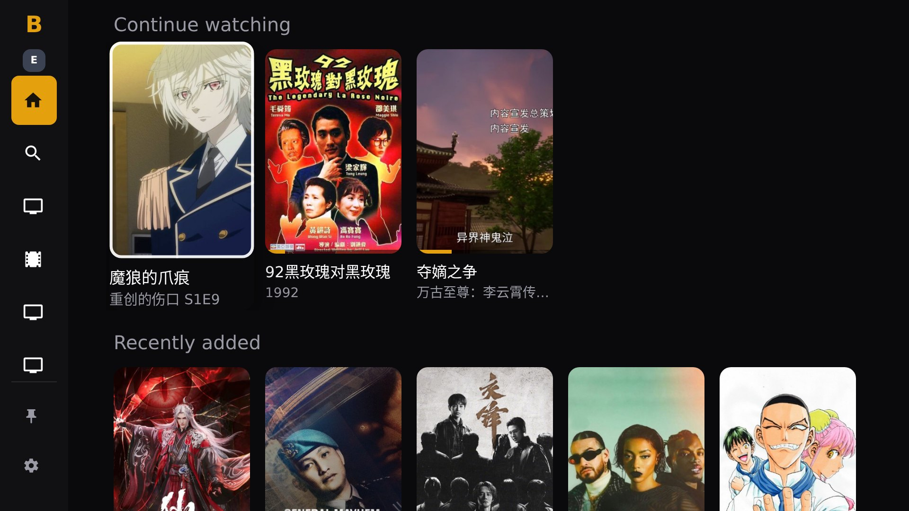
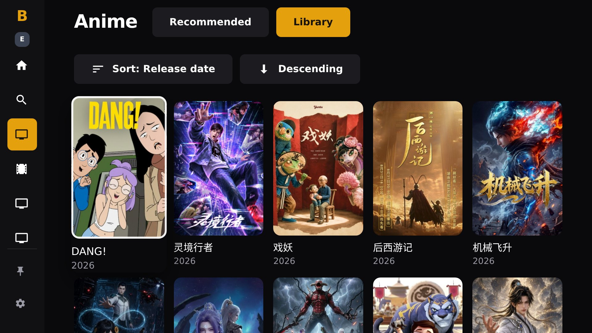
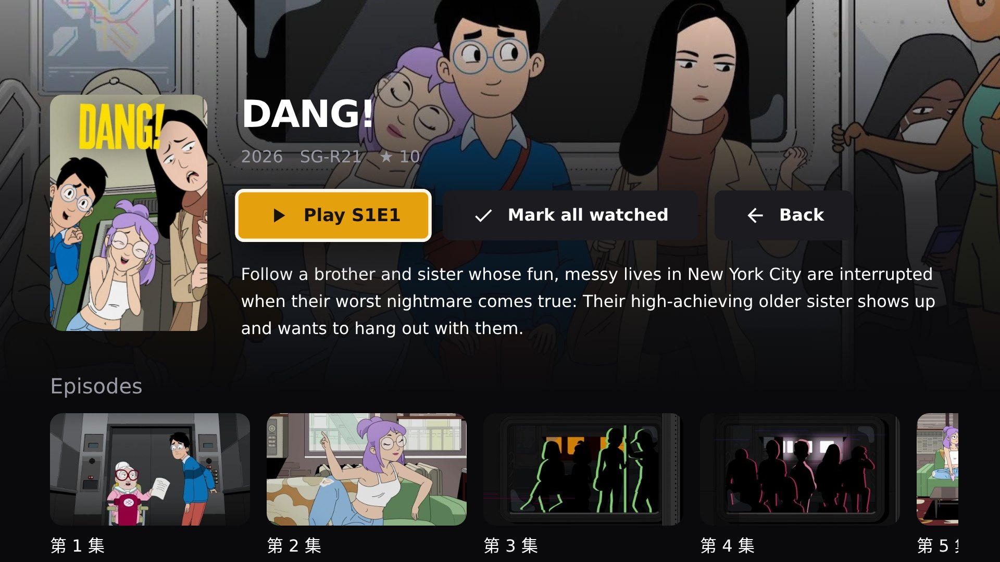
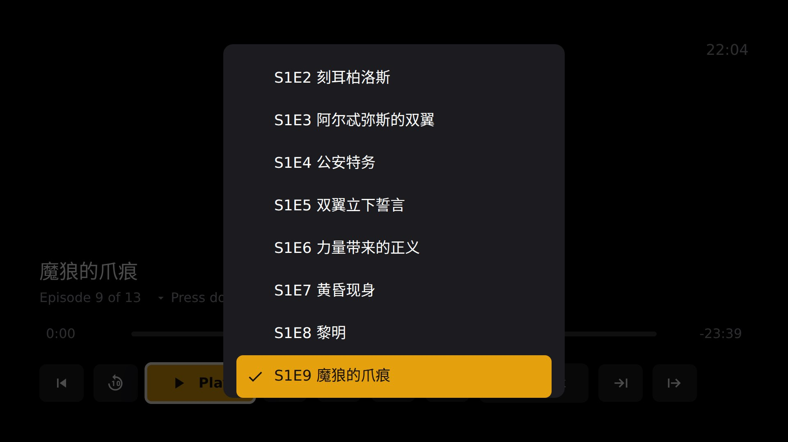
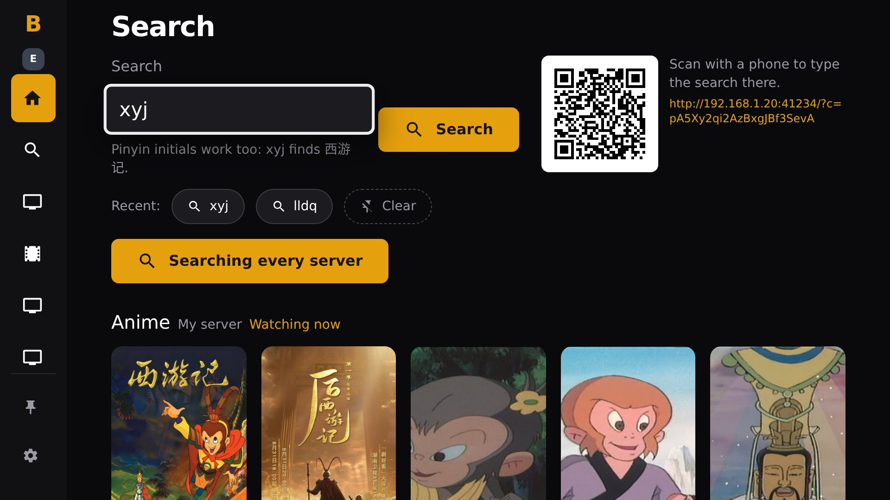
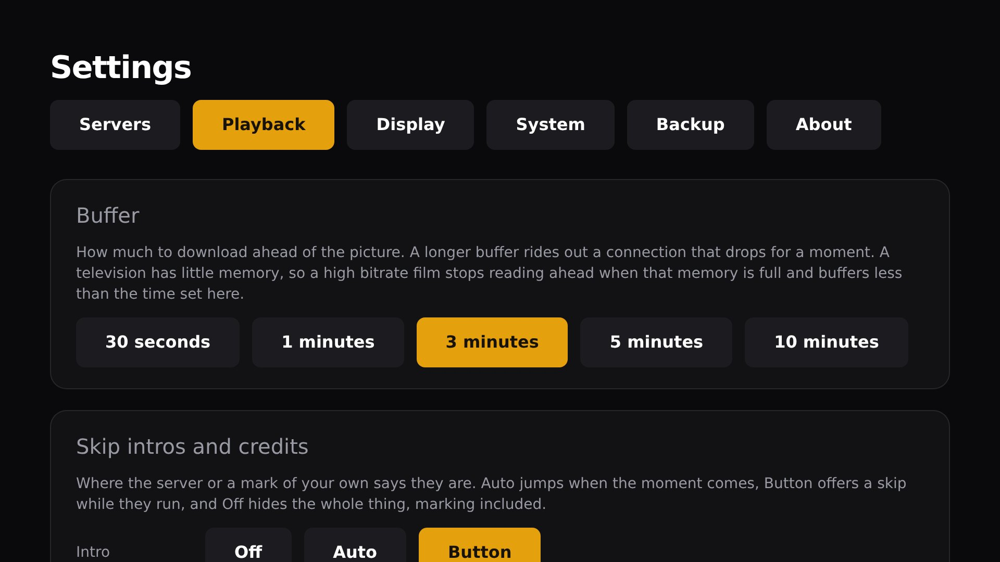

[简体中文](README.md) | English

An Emby client for Android TV, built for a remote control rather than a touchscreen.

**Latest version 0.6.22**, released 2026-10-29. Requires Android 7.0 or newer
(API 24).

## Screenshots

On a television, at 1080p.

<table>
<tr>
<td></td>
<td></td>
</tr>
<tr>
<td></td>
<td></td>
</tr>
<tr>
<td></td>
<td></td>
</tr>
</table>

## Download

| Download | Best for | Size |
| --- | --- | --- |
| [universal](https://github.com/liveinaus/bemplayer/releases/download/v0.6.22/bemplayer-0.6.22-universal.apk) | Works on every Android TV device | 25.1 MB |

`universal` is the one to take: it works on every device. If Bemplayer opens with a screen
saying the TV's WebView is too old, that screen says what can be done, and on a TV with
Google's WebView it can download and install a newer one itself. A newer WebView is a
system component shared by every app on the TV, and Settings → Apps → Android System
WebView → Uninstall updates puts the old one back.

## Install

Android TV will not install an app from a file until you allow it. The prompt appears the
first time and points at the right settings screen.

**With a file manager or sideload app** such as Downloader or Send Files to TV: copy the
APK across, open it, and accept the install prompt.

**With adb**, from a computer on the same network:

```bash
adb connect <tv-ip>:5555
adb install -r bemplayer-0.6.22-universal.apk
```

Then open Bemplayer from the Android TV home screen and enter your Emby server address,
for example `http://192.168.1.10:8096`.

## Updates

Bemplayer checks for new versions on its own and can install them without a computer.
Settings, then Updates, then Check now. Auto check is on by default and can be turned off
on the same screen.

The first update asks you to allow Bemplayer to install apps. That permission is what lets
it replace itself, and the app takes you straight to the setting.

## Using the remote

| Key                | In the player                                                              |
| ------------------ | -------------------------------------------------------------------------- |
| Centre, play/pause | Play or pause                                                              |
| Left, right        | Seek. Hold to go faster: 10s, 30s, 1m, 5m                                  |
| Up                 | Up a row of buttons; from the top row, hide the controls                   |
| Down               | Down a row of buttons; again for the episode strip; hold for the list      |
| Back               | Close the menu or QR code, then the episode strip, then ask before leaving |

Anywhere else, Back goes back one screen and never closes the app on its own. At the
screen with nothing behind it, Back asks whether to quit Bemplayer; holding Back leaves
at once, without asking.

The green button opens the logs from any screen (Settings › System › Logs on a remote
without one), which is the quickest way to get
information for a bug report.

## What is in this release

### 新增 / Added

- 隐私模式（家长控制）：在「设置 › 系统 › 密码锁」里选择要隐藏的服务器和媒体库。隐私模式开启时，隐藏的服务器就像从没登录过：不会列出、不会被搜索，也看不到它的观看记录。用遥控器方向键输入密码关闭隐私模式，一键即可重新开启；启动时和离开几分钟后会自动开启。屏幕锁和隐私模式互相独立：屏幕锁可以关闭，只用隐私模式；解锁屏幕锁不会关闭隐私模式，所以可以替孩子解锁而隐藏的内容仍然隐藏。 / Privacy mode (parental control): choose servers and libraries to hide under Settings › System › Passcode. While privacy is on, a hidden server is as if never signed in to: not listed, not searched, and none of what was watched on it shows. The passcode, entered with the remote's arrows, turns privacy off, one press turns it back on, and it comes back on at launch and after a few minutes away. The screen lock and privacy are separate: the lock can be turned off to use privacy alone, and unlocking the screen never turns privacy off, so a child can be let in with what is hidden still hidden.

### 修复 / Fixed

- 第二字幕不显示：第一字幕关闭时第二字幕不出现，ASS 格式的第二字幕也读不出内容，快进后第二字幕还会被关掉。现在单独选第二字幕也能显示，ASS 字幕也能读，快进后仍然保留。 / The second subtitle never showed: it did not appear with the first subtitle off, an ASS second subtitle read as empty, and a jump forward switched it off. It now shows on its own, reads ASS, and stays on through a jump.
- 看片途中与服务器的连接断了（比如经 Cloudflare 隧道的线路），播放会直接停下报错，要手动重新播放。现在会显示「正在重新连接…」并自动重连，从断开的地方接着播；没有报错只是卡住不动时也会重连。服务器五分钟都连不上才显示错误。 / When the connection to the server dropped mid-film (a route through a Cloudflare tunnel, say), playback stopped with an error until it was played again by hand. It now says it is reconnecting and picks up where it stopped, including when the stream froze without an error; only a server away for five minutes ends in an error.

What changed in every earlier version is in the [changelog](CHANGELOG.md).

## Verifying a download

```
27735cbf1e24a96fda51390af09821f6b87a79139d3cfa66ec297cb01e701c0c  bemplayer-0.6.22-universal.apk
```

Check one with `sha256sum bemplayer-0.6.22-universal.apk`.

## Reporting a problem

Open an issue at https://github.com/liveinaus/bemplayer/issues. The most useful thing you can attach
is a log export: press the green button on the remote (or open Settings › System ›
Logs), then Export, and the screen tells
you where the files landed.

Please include your device model, the Android version and the Emby server version.

For bug reports, suggestions or a chat, there is also the Telegram group
[@bemplayer](https://t.me/bemplayer). Its QR code is under Settings → About in the app.

## About this repository

This repository publishes builds only. It holds the releases, this page and
`update.json`, which is the file the app polls to discover new versions. The source is
kept in a separate private repository, and each release records the commit it was built
from: `bb3a0a5`.

Version 0.6.22 is build 622.
