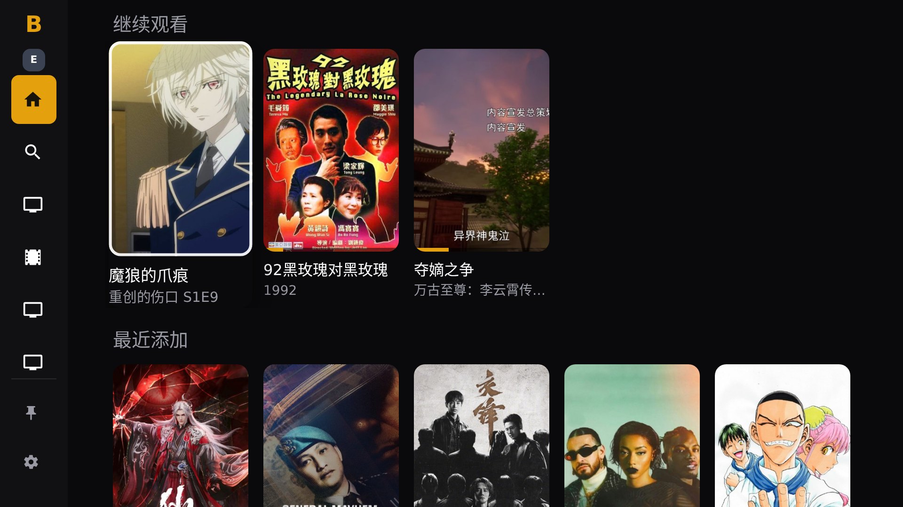
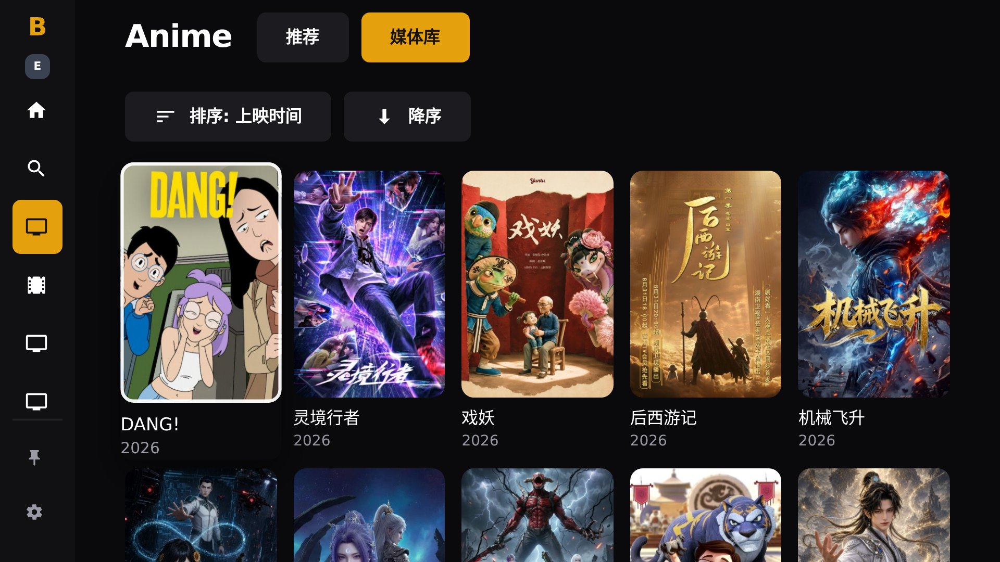
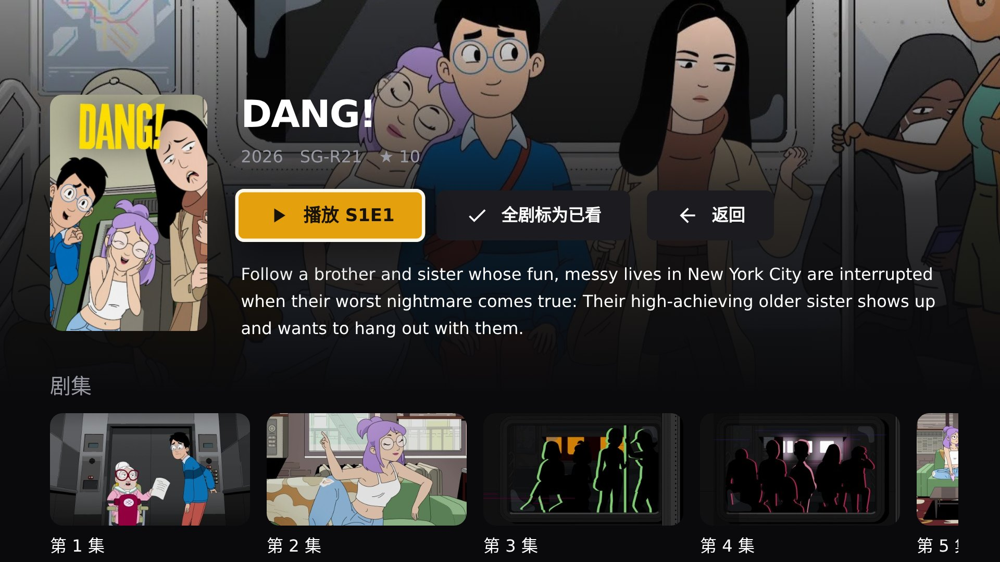
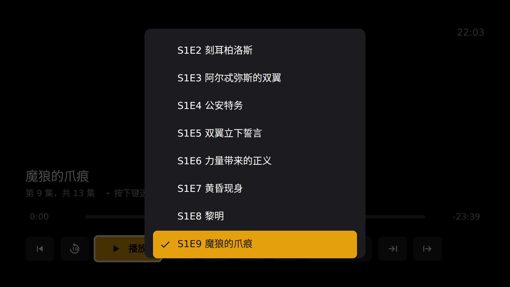
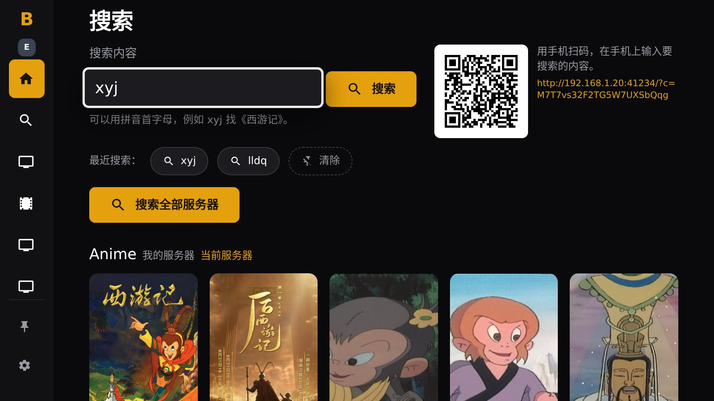
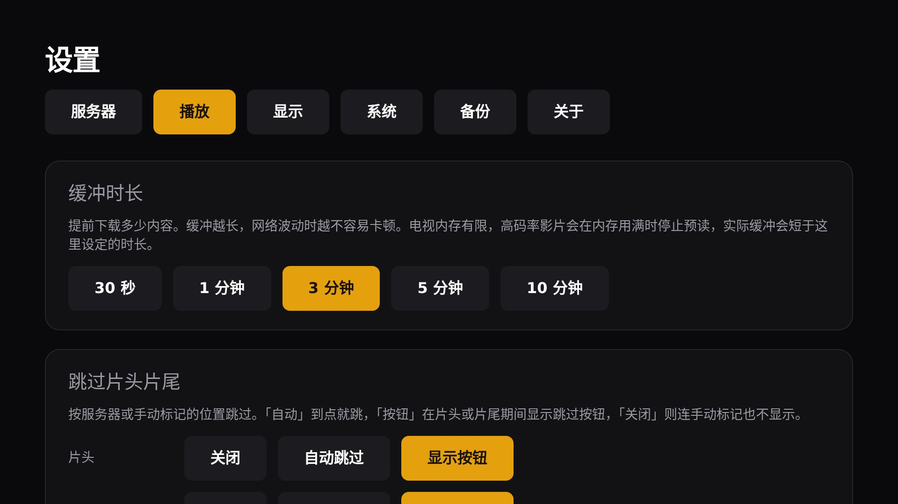

简体中文 | [English](README.en.md)

一款为 Android TV 打造的 Emby 客户端，为遥控器而设计，而不是触摸屏。

**最新版本 0.6.23**，发布于 2026-11-03。需要 Android 7.0
或更高版本（API 24）。

## 截图

在电视上的样子（1080p）。

<table>
<tr>
<td></td>
<td></td>
</tr>
<tr>
<td></td>
<td></td>
</tr>
<tr>
<td></td>
<td></td>
</tr>
</table>

## 下载

| 下载 | 适合 | 大小 |
| --- | --- | --- |
| [universal](https://github.com/liveinaus/bemplayer/releases/download/v0.6.23/bemplayer-0.6.23-universal.apk) | 适用于所有 Android TV 设备 | 25.1 MB |

下载 `universal` 即可，所有设备都能用。如果打开 Bemplayer 后显示「此电视的 WebView 太旧」，那个界面会说明
可以怎么做；使用 Google WebView 的电视可以在界面上直接下载并安装新版。新的 WebView 是电视上所有应用共用的
系统组件，如需恢复：设置 → 应用 → Android System WebView → 卸载更新。

## 安装

Android TV 默认不允许安装来自文件的应用。第一次安装时会弹出提示，并直接指向对应的设置页面。

**用文件管理器或投送工具**，例如 Downloader 或 Send Files to TV：把 APK 传到电视上，打开
它，同意安装提示。

**用 adb**，在同一网络的电脑上执行：

```bash
adb connect <电视的IP>:5555
adb install -r bemplayer-0.6.23-universal.apk
```

然后在 Android TV 主界面打开 Bemplayer，填入你的 Emby 服务器地址，例如
`http://192.168.1.10:8096`。

## 更新

Bemplayer 会自行检查新版本，不用电脑也能安装。进入设置，再进更新，然后点立即检查。自动检查
默认开启，也可以在同一个页面关掉。

第一次更新会请求允许 Bemplayer 安装应用。正是这个权限让它可以替换自己，应用会直接带你到那个
设置项。

## 遥控器按键

| 按键              | 在播放器中                                             |
| ----------------- | ------------------------------------------------------ |
| 确定键、播放/暂停 | 播放或暂停                                             |
| 左、右            | 快退快进。按住会加速：10 秒、30 秒、1 分、5 分         |
| 上                | 回到上一行按钮；在最上一行时收起控制栏                 |
| 下                | 到达下一行按钮；再按展开剧集缩略图条；长按打开选集列表 |
| 返回              | 先关菜单或二维码，再收起剧集条，最后询问是否停止播放   |

在其他界面，返回键是返回上一层，不会自己关掉应用。回到没有上一层可回的那一屏时，按返回会询问
是否退出 Bemplayer；长按返回则直接退出，不再询问。

绿色按键在任何界面都能打开运行日志（遥控器没有绿色按键时，在 设置 › 系统 › 运行日志 打开），这是拿到反馈问题所需资料最快的办法。

## 这个版本有什么

### 新增 / Added

- 服务器同步：在「设置 › 同步」里填入第三方面板的同步地址和同步密钥（可用手机扫码粘贴），面板上共享的 Emby 服务器会自动添加，包括备用线路和登录信息；面板上修改密码或线路、取消共享，这里都会跟着更新。启动和回到应用时自动同步（最多每 10 分钟一次），也可以立即同步。同步只会移除它自己添加的服务器，手动添加的服务器不受影响。 / Server sync: enter a third-party panel's sync address and sync key under Settings › Sync (or paste them on a phone from the QR code), and the Emby servers the panel shares are added for you, backup lines and sign-in included. A password or line changed on the panel, or a server no longer shared, is followed here. Sync runs on launch and on coming back to the app (at most every 10 minutes) and on demand. It only ever removes servers it added itself; ones added by hand are left alone.
- 字幕按剧记住：看一部剧时打开或关闭字幕，同一部剧的其他集会自动用同样的选择（按名称、语言和格式匹配）。 / Subtitles are remembered per show: turn them on or off in one episode and the show's other episodes follow, matched by name, language and format.

### 修复 / Fixed

- 在电视上编辑已添加服务器的线路：按「线路」后面板会滚动到屏幕内并获得焦点，按返回回到原来的按钮；之前面板出现在屏幕下方，看起来按了没反应。 / Editing an existing server's addresses on a television: pressing Addresses now scrolls the panel onto the screen and moves focus into it, and Back returns to the button. Before, the panel opened below the screen, so the press looked like it did nothing.

以前每个版本改了什么，见 [更新日志](CHANGELOG.md)。

## 校验下载的文件

```
7d5948631cc786f0f50b4fb1020c5ec24b8380cf393a1b4ae0f69648de51b166  bemplayer-0.6.23-universal.apk
```

用 `sha256sum bemplayer-0.6.23-universal.apk` 校验其中一个。

## 反馈问题

到 https://github.com/liveinaus/bemplayer/issues 提交 issue。最有用的附件是日志导出：按遥控器上的绿色
按键（或 设置 › 系统 › 运行日志），然后选导出，屏幕上会告诉你文件放在哪里。

请一并附上设备型号、Android 版本和 Emby 服务器版本。

问题反馈、功能建议或随便聊聊，也可以加入 Telegram 群组 [@bemplayer](https://t.me/bemplayer)。
应用里 设置 → 关于 有它的二维码。

## 关于这个仓库

这个仓库只发布构建产物。它存放各个发行版、这个页面，以及 `update.json`，也就是应用用来发现新
版本的那个文件。源代码放在另一个私有仓库里，每次发布都会记录它构建自哪个提交：
`2364b2c`。

版本 0.6.23 是第 623 号构建。
